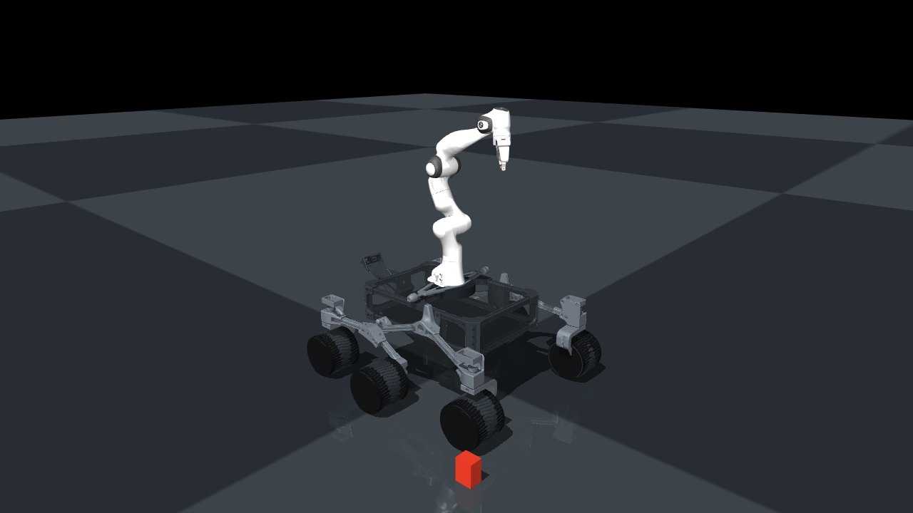

# MoonBot-X

MoonBot-X is a reproducible MuJoCo research platform for robust whole-body control and learning on a six-wheel mobile manipulator. It combines a 2x research-scale Sawppy/Curio rocker-bogie rover with the MuJoCo Menagerie Franka Emika Panda arm and gripper.



## Research question

Can a dynamics-aware controller coordinate rover locomotion and arm motion on uneven terrain while remaining robust to wheel slip, uncertain payloads, model mismatch, sensing noise, delays, and external disturbances?

The implemented comparison supports:

- decoupled base PID and gravity-compensated arm control;
- reduced-order CasADi/IPOPT MPC with logged solve status and PID fallback;
- operational-space arm control with damped Jacobians and joint-limit avoidance;
- end-to-end PPO;
- residual PPO over the nominal controller;
- domain-randomized residual PPO;
- OSQP action projection with actuator/rate constraints and documented heuristic stability rules.

## Robot and simulator

The rover has six driven wheels, four steering joints, passive left/right rockers and bogies, and a compliant rocker differential. The Panda retains Menagerie meshes, link inertias, joint limits, hand, tendon-coupled fingers, and fingertip sensors. Rover masses, collision bodies, actuator limits, mount, and 2x scaling remain provisional research assumptions.

MuJoCo 3.x is canonical. The deployment observation contains 76 normalized, physically measurable values: gravity in the base frame, IMU signals, wheel/arm encoders, desired motion, relative end-effector target, prior action, estimated velocity, wheel and finger contacts, gripper state, task stage, and terrain samples. The 14-value policy action controls six wheel and seven arm corrections plus gripper opening.

## Implemented tasks

1. Flat-ground velocity tracking.
2. Rough-terrain waypoint navigation over ramps, sinusoidal fields, discrete obstacles, asymmetric terrain, and low friction.
3. Stationary Cartesian arm reaching.
4. Mobile end-effector tracking.
5. Payload transport.
6. Staged mobile manipulation: approach, reach, contact grasp, lift, transport, lower, and place.

The deterministic mobile-manipulation demonstration picks a 50 x 50 x 80 mm, 20 g foam block directly from the ground with bilateral friction contact, drives the articulated rover 0.808 m, transports the block 0.795 m, and places it upright on a fixed flush-ground marker with 1.11 mm planar error. Bilateral contact is retained throughout rover transport with 1.30 mm maximum measured grasp drift. No weld, object following, or kinematic attachment exists in the model. The provisional gripper assumptions are documented 56 mm silicone jaw liners and a friction coefficient of 2.0; hardware identification is still required.

## Installation

Canonical environment:

```bash
python3.11 -m venv .venv
source .venv/bin/activate
pip install -e ".[analysis,control,learning,test]"
```

The current Ubuntu development venv is `/home/manee/venv` and uses Python 3.12, which is inside the supported `>=3.11,<3.15` range.

## Quick start

```bash
python scripts/build_mobile_panda_model.py
python -m moonbot.cli validate-model --output results/model_validation.json
python -m moonbot.cli rollout --task velocity_tracking --controller pid --duration 5
python -m moonbot.cli pick-place-demo \
  --output results/pick_place_smoke \
  --render \
  --video-output results/video_smoke/rollout.mp4
python -m moonbot.cli mobile-pick-place-showcase \
  --output results/mobile_pick_place_showcase \
  --fps 15
pytest -q
ruff check .
```

Run the complete CPU smoke pipeline:

```bash
SMOKE_STEPS=2048 PYTHON_BIN=/home/manee/venv/bin/python \
  bash scripts/run_headless_smoke.sh
```

## Training

Pure PPO:

```bash
python -m moonbot.cli train \
  --config configs/training/ppo.yaml \
  --seed 1 \
  --output results/final/ppo/seed_1
```

Domain-randomized, safety-filtered residual PPO:

```bash
python -m moonbot.cli train \
  --config configs/training/residual_ppo.yaml \
  --seed 1 \
  --output results/final/residual_ppo_safe/seed_1
```

Training records the full configuration, package/platform metadata, seed, timestamps, CSV and TensorBoard logs, curriculum transitions, and checkpoints. The nine-stage curriculum is applied to vector environments on episode reset; it progresses from nominal velocity tracking through slopes, coordinated manipulation, payload variation, disturbances, and delayed/noisy sensing. Supported ablations are exposed through `--ablation`.

## Evaluation and benchmark reproduction

```bash
python -m moonbot.cli evaluate \
  --controller residual_ppo_safe \
  --checkpoint results/final/residual_ppo_safe/seed_1/checkpoints/final.zip \
  --scenario-manifest configs/evaluation/full_benchmark.yaml \
  --output results/final/evaluation/residual_safe_seed_1

python -m moonbot.cli benchmark \
  --controllers pid mpc ppo residual_ppo residual_ppo_safe \
  --checkpoint ppo=path/to/ppo.zip \
  --checkpoint residual_ppo=path/to/residual.zip \
  --checkpoint residual_ppo_safe=path/to/residual.zip \
  --scenario-manifest configs/evaluation/full_benchmark.yaml \
  --output results/full_benchmark

python -m moonbot.cli plot --results results/full_benchmark
```

Episode-level results are written to Parquet. Summaries contain means, standard deviations, and episode-bootstrap 95% intervals; paired differences use matching scenario seeds. The exports include position/heading and end-effector pose errors, slip, effort, peak actuator force, contact impulse, collision and constraint rates, stability, disturbance recovery, safety interventions, latency, and MPC fallback/solve time. Every safety projection is saved with its trigger, original and filtered actions, solve status, and eventual episode outcome. Representative trajectories and failure categories are stored separately.

## Verified smoke results

These results validate execution, not controller superiority. The latest full smoke checkpoints received only 256 training steps and benchmark episodes were intentionally limited to 1.0 second.

| Gate | Smoke result |
|---|---:|
| Automated regression tests | 27/27 passed |
| Mechanical validation | 20/20 passed |
| Mobile ground pick and place | all seven deterministic stages passed |
| Articulated rover / block transport | 0.808 m / 0.795 m |
| Transport grasp | 100% bilateral contact; 1.30 mm maximum drift |
| Final placement | upright, 1.11 mm planar error |
| Attachment mechanism | none; friction contact only |
| Pure PPO training | 256 steps, checkpoint saved and reloaded |
| Residual PPO training | 256 steps, checkpoint saved and reloaded |
| Six-controller benchmark | 36 paired short episodes saved |
| Headless video | 25.1 s ground pick/lift/rover transport/place MP4, visually inspected |

Representative smoke plots are in `results/full_pipeline_smoke/plots/`. The plotting pipeline covers tracking, success, slip/energy, robustness, stability, safety interventions, latency, failure categories, trajectories, architecture, terrain families, and learning curves. No scientific performance conclusion is drawn from these short runs.

## Learned-policy study status

The repository defines a five-seed, 40-job learned-controller and ablation study:

```bash
PYTHON_BIN=/path/to/venv/bin/python FINAL_STEPS=1000000 \
  bash scripts/run_gpu_study.sh
```

A Slurm template is provided at `scripts/slurm_full_study.sh`. Final completion still requires the five long learned-policy runs, 100 episodes per scenario, held-out robustness evaluation, ablations, and failure analysis. Those results must be generated on the server; they are not fabricated here.

An initial server study produced seven one-million-step checkpoints before audit exposed that the deployed server revision counted manipulation stage 5 (object at the target while still held) as success. A nominally successful rollout stopped after 99 steps at stage 5 with only 0.0855 m payload displacement. That study was halted, its checkpoints were retained for diagnosis, and no learned pick-and-place success is claimed. The current source requires stage 7: upright ground placement, ground support, and released bilateral finger contact. A short corrected multi-seed gate must pass before restarting the full study.

## Documentation

- [Robot design](docs/robot_design.md)
- [Model validation](docs/model_validation.md)
- [Controller design](docs/controller_design.md)
- [Environment design](docs/environment_design.md)
- [Evaluation protocol](docs/evaluation_protocol.md)
- [Hardware plan](docs/hardware_plan.md)
- [Research report](docs/research_report.md)
- [Limitations](docs/limitations.md)
- [External assets and licenses](docs/external_assets.md)
- [CV-ready technical project points](docs/CV_POINTS.md)

## Citation

MoonBot-X is an original composite research implementation. If used in academic work, cite this repository and the upstream Sawppy/Curio and MuJoCo Menagerie Panda assets listed in `docs/external_assets.md`.
