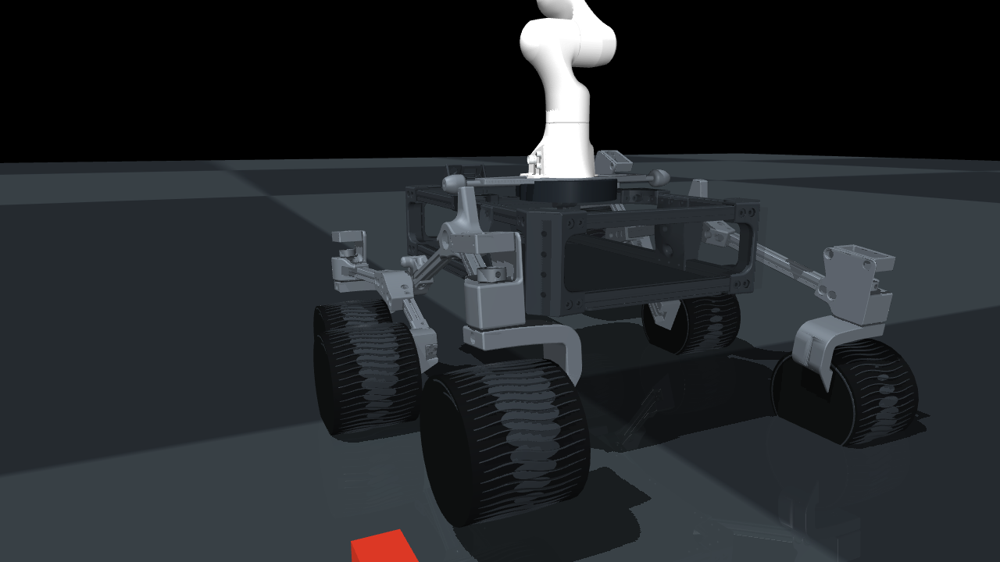
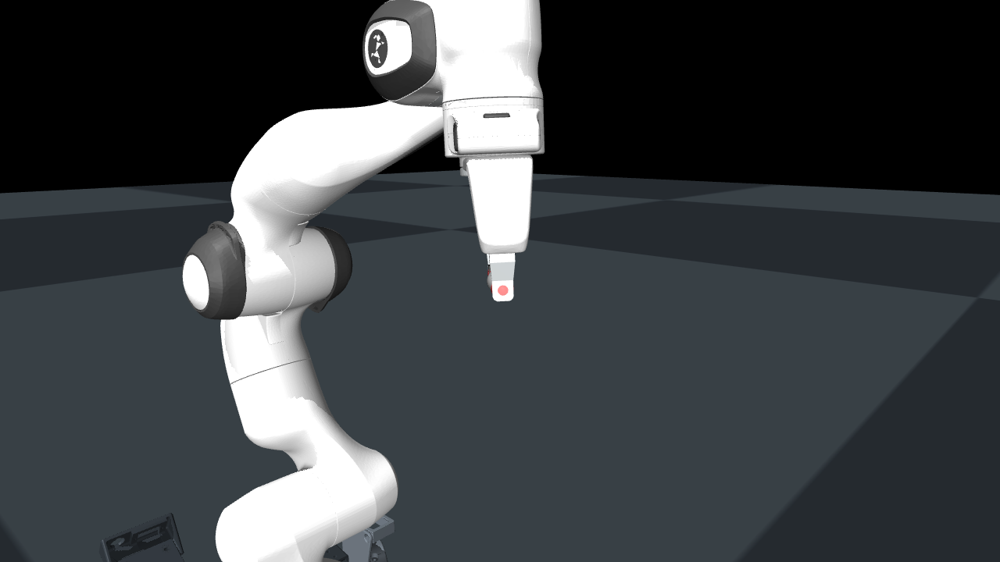

# Rover and manipulation design

## Rover base

The base uses Sawppy's six-wheel rocker-bogie arrangement as represented by Curio. A passive rocker on each side carries the front steering assembly and a passive bogie; each bogie carries the middle drive wheel and rear steering assembly. A compliant equality constraint couples the left and right rocker angles to approximate the chassis-level action of Sawppy's closed-loop differential.

The four corner wheels steer independently and all six wheels are independently torque driven. This supports future Ackermann, point-turn, and mixed steering controllers, although the current baseline applies straight steering and left/right drive-torque mixing.

| Parameter | Model value | Status |
|---|---:|---|
| Chassis envelope | 0.85 x 0.57 x 0.186 m | research configuration |
| Ballasted chassis mass | 45.0 kg | provisional |
| Wheel radius | 0.12 m | 2x source geometry |
| Wheel width | 0.20 m | 2x source geometry |
| Steering travel | +/-0.75 rad | provisional |
| Rocker/bogie travel | +/-0.7854 rad | provisional |
| Wheel torque bound | +/-30 N m | provisional |

Visual STL meshes are used only for appearance. Simple collision primitives and explicit mass properties keep contact and dynamics tractable. The approximation omits turnbuckles, differential gearing, bearing clearances, tire deformation, structural flexure, and cable routing.

## Franka Panda arm

The unscaled Menagerie Panda rigid-body model is mounted on a 2.5 kg adapter above the rover chassis. It retains seven revolute joints, upstream joint ranges and inertial tensors, detailed visual/collision meshes, and the Panda hand. The validated home pose has a 0.7277 m shoulder-to-tool distance.

Arm joints are controlled by torque motors with bounds of +/-87 N m for joints 1-4 and +/-12 N m for joints 5-7. These bounds support the research controller interface; they do not certify that the mobile mounting structure can withstand the corresponding loads.

## Parallel-jaw gripper

The Panda gripper has two equality-coupled fingers driven through the Menagerie tendon. Each finger travels from 0 to 40 mm for an 80 mm modeled maximum opening. One position command controls the tendon, and touch sites on both fingertips expose contact forces.

The dynamic smoke test verifies full open-close travel. Manipulation performance is evaluated separately: the block remains a free body, bilateral finger contact is measured from MuJoCo contacts, and the deterministic mobile showcase records contact retention, grasp drift, transport distance, ground support, release, upright orientation, and placement error. These simulation measurements are not evidence of hardware grasp stability.

## Fabrication boundary

This composite model is suitable for simulation and controller development. Before fabrication it requires motor and gearbox selection, drivetrain sizing, Panda mount finite-element analysis, bearing/shaft design, stability and tip-over analysis, cable routing, tolerancing, and CAD-derived mass-property replacement.
